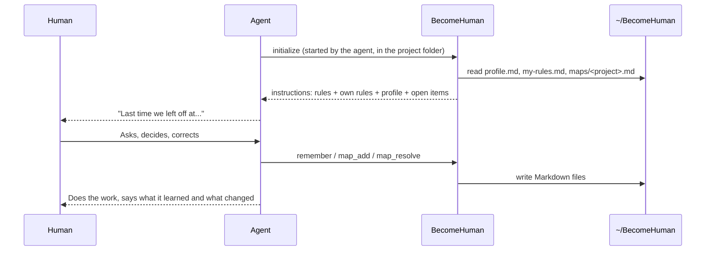

# Contributing

Thanks for helping agents work better with humans.

## How to send a change

1. Fork the repository and create a branch from **`develop`**.
2. Make a small, focused change with tests.
3. Open a pull request **to `develop`**. Pull requests to `main` are closed.
4. The maintainer ([@DanielDDHM](https://github.com/DanielDDHM)) reviews it.
   Nothing is merged without that review.

`main` is the stable version everyone installs. It only receives `develop`,
merged by the maintainer when a release is ready.


**Personal data never comes to this repository.** Profiles, personal rules and idea maps
belong to each operator and stay on their computer. They are ignored by git, and pull
requests that include them are closed.

Both branches are protected: no direct pushes, no force pushes, no deletion,
and every pull request needs an approved review from the code owner.

## Run it

```bash
npm install   # also builds
npm test      # unit and integration tests (Jest)
npm start     # runs the server on stdio
```

Running `node dist/index.js` in a terminal shows the banner instead of waiting for an agent.

## How it works



The MCP `instructions` field carries everything the agent needs on connect,
so continuity does not depend on the agent remembering to call a tool.
It is kept small on purpose: compact rules, one line per profile topic, and only the
open items of the current project. The full map is one `get_map` call away.

## Tools

| Tool | What it does |
| --- | --- |
| `get_rules` | Reread the human-first rules |
| `remember` / `forget` / `get_profile` | Learn, unlearn (by its words) and list facts about the operator |
| `get_map` / `map_add` / `map_resolve` | Read and grow a project's idea map |
| `where_is_my_data` | Tell the human where their files are |

## File formats

The Markdown files are the single source of truth, made for people first.
Writes change only the lines they need: notes and anything else the human wrote stay in place.

**profile.md:** one `##` heading per topic, one `-` bullet per fact.

**maps/&lt;project&gt;.md:** a nested checklist. Each line is `- [ ] <icon> #<id> <text>`,
indented two spaces under its parent. Icons: 💡 idea, ✅ decision, ❓ question, ➡️ next step.
Lines added by hand may skip the icon and the id: they become ideas with new ids.

## Code map

| Path | Responsibility |
| --- | --- |
| `rules/human-first.md` | The rules. Edit here to change behavior. |
| `art/creation.txt` | The hands shown in the terminal banner |
| `src/config.ts` | Settings from environment variables |
| `src/i18n.ts` | Texts the human reads in their files, per language |
| `src/paths.ts` | Where each file lives |
| `src/profile/` | What the agent learns about the operator |
| `src/ideaMap/` | Idea maps: Markdown parsing, writing and summary |
| `src/tools/` | MCP tools |
| `src/server.ts` | MCP server: instructions and tools |
| `src/index.ts` | Entry point: banner for people, stdio for agents |

## Releasing (maintainer)

1. Bump the version in `package.json`, `server.json` (both fields) and `plugin/.claude-plugin/plugin.json`.
2. Pin the same version in `plugin/.mcp.json` (`become-human@x.y.z`), as the directory requires.
3. `npm publish --access public` from a regular terminal (2FA in the browser).
4. `mcp-publisher publish` to update the [MCP Registry](https://registry.modelcontextprotocol.io).

| Path | Used by |
| --- | --- |
| `server.json` | MCP Registry |
| `.claude-plugin/marketplace.json` | Claude Code marketplace (`/plugin marketplace add`) |
| `plugin/` | The Claude Code plugin: starts the npm package as an MCP server |

## Commits

Small, focused commits with conventional prefixes (`feat:`, `fix:`, `docs:`).
