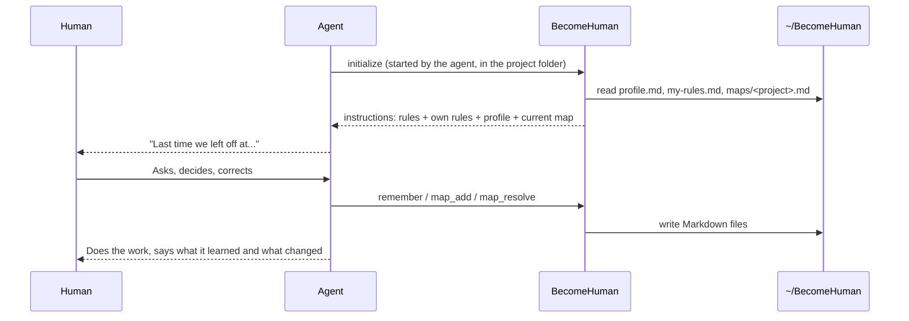

# Contributing

## Run it

```bash
npm install   # also builds
npm test      # unit and integration tests (Jest)
npm start     # runs the server on stdio
```

Running `node dist/index.js` in a terminal shows the banner instead of waiting for an agent.

## How it works



The MCP `instructions` field carries everything the agent needs on connect,
so continuity does not depend on the agent remembering to call a tool.

## Tools

| Tool | What it does |
| --- | --- |
| `get_rules` | Reread the human-first rules |
| `remember` / `forget` / `get_profile` | Learn, unlearn and list facts about the operator |
| `get_map` / `map_add` / `map_resolve` | Read and grow a project's idea map |
| `where_is_my_data` | Tell the human where their files are |

## File formats

The Markdown files are the single source of truth, made for people first.

**profile.md:** one `##` heading per topic, one `-` bullet per fact.

**maps/&lt;project&gt;.md:** a nested checklist. Each line is `- [ ] <icon> #<id> <text>`,
indented two spaces under its parent. Icons: 💡 idea, ✅ decision, ❓ question, ➡️ next step.
Lines added by hand may skip the icon and the id: they become ideas with new ids.

## Code map

| Path | Responsibility |
| --- | --- |
| `rules/human-first.md` | The rules. Edit here to change behavior. |
| `art/creation.txt` | The hands shown in the terminal banner |
| `src/config.ts` | Settings from environment variables |
| `src/i18n.ts` | Texts the human reads in their files, per language |
| `src/paths.ts` | Where each file lives |
| `src/profile/` | What the agent learns about the operator |
| `src/ideaMap/` | Idea maps: Markdown parsing, writing and summary |
| `src/tools/` | MCP tools |
| `src/server.ts` | MCP server: instructions and tools |
| `src/index.ts` | Entry point: banner for people, stdio for agents |

## Commits

Small, focused commits with conventional prefixes (`feat:`, `fix:`, `docs:`).
