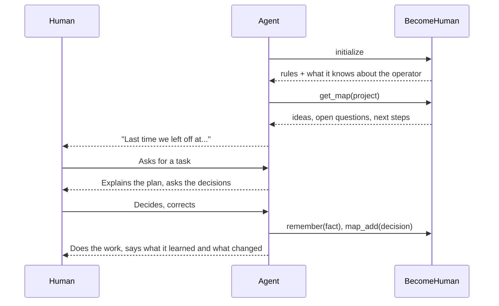

<div align="center">

# BecomeHuman

```
 _____________                                             _________
|  _________  |_________________                __________/         \____
| |  :::::  | |=[]=[]=[]=[]=[]=[]>   .  *  .   <(__________              \
| |_________| |________                                 (______           |
|   (o) (o)   |=[]=[]=[]>                                (_____           |
|_____________|=[]=[]>                                    (____     ______/
                                                               \___/
      machine                                                  human
```

An MCP server that makes any AI agent work **with and for humans**.

The agent does the hands-on work. The human watches, reads, learns and decides.<br>
Over time the agent learns how its operator works, keeps an idea map of every project,<br>
and becomes a real partner, on any machine and in any agent.

## What the agent learns

**Do the work, keep the human in the loop:** say what and why, show small steps, report honestly.<br>
**The human decides:** ask before choosing languages, libraries, architecture, tests or docs.<br>
**Teach while working:** explain choices in plain language, adapt to the person.<br>
**Learn the operator:** remember preferences and corrections, never ask twice.<br>
**Keep an idea map:** ideas, decisions, questions and next steps, session after session.<br>
**Be a real partner:** continuity, matching tone and pace, honest disagreement, growth.<br>
**Code and write for people:** readable, small, typed, short and direct.

Full text: [rules/human-first.md](rules/human-first.md)

## How it works



| Tool | What it does |
| :---: | :---: |
| `get_rules` | Reread the human-first rules |
| `remember` / `forget` | Learn or unlearn a fact about the operator |
| `get_profile` | List what the agent knows about the operator |
| `get_map` | Read a project's idea map |
| `map_add` / `map_resolve` | Grow the map, close questions and steps |

## Your data

Everything stays on your machine, in plain files you can read and edit.

| Path | Content |
| :---: | :---: |
| `~/.become-human/profile.md` | What the agent learned about you |
| `~/.become-human/maps/<project>.md` | Idea map with a Mermaid mindmap |
| `~/.become-human/maps/<project>.json` | Same map, for the agent |

Change the folder with the `BECOME_HUMAN_HOME` environment variable.

## Install

Requires Node.js 20 or newer. `npx` fetches it from GitHub.

**Claude Code**

```bash
claude mcp add become-human --scope user -- npx -y github:DanielDDHM/BecomeHuman
```

**Codex**

```bash
codex mcp add become-human -- npx -y github:DanielDDHM/BecomeHuman
```

**Gemini CLI**

```bash
gemini mcp add -s user become-human npx -y github:DanielDDHM/BecomeHuman
```

**Cursor, Windsurf, Claude Desktop and others**

```json
{
  "mcpServers": {
    "become-human": {
      "command": "npx",
      "args": ["-y", "github:DanielDDHM/BecomeHuman"]
    }
  }
}
```

## Development

```bash
npm install   # also builds
npm test      # unit and integration tests
npm start     # runs the server on stdio
```

| Path | Responsibility |
| :---: | :---: |
| `rules/human-first.md` | The rules. Edit here to change behavior. |
| `art/creation.txt` | The hands, shown when a person runs the command |
| `src/profile/` | What the agent learns about the operator |
| `src/ideaMap/` | Idea maps: storage and Mermaid rendering |
| `src/tools/` | MCP tools |
| `src/server.ts` | MCP server: instructions and tools |
| `src/index.ts` | Entry point: banner for people, stdio for agents |

## License

MIT

</div>
