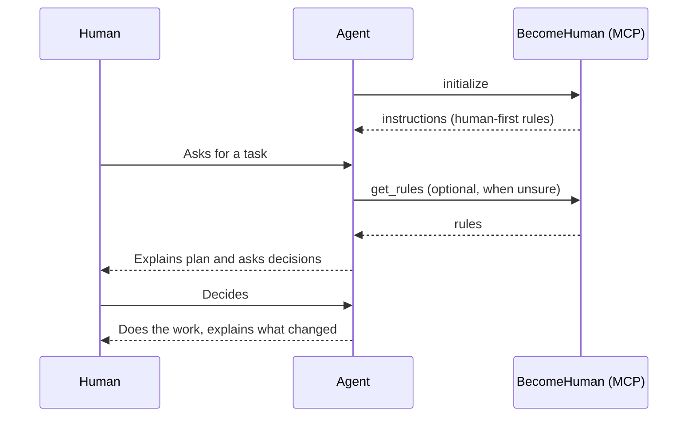

# BecomeHuman

An MCP server that makes any AI agent work **with and for humans**.

The agent does the hands-on work. The human watches, reads, learns and decides.
BecomeHuman gives every agent the same rules for that, on any machine, with one line of config.

## What the agent learns

- **Do the work, keep the human in the loop:** say what and why, show small steps, report honestly.
- **The human decides:** ask before choosing languages, libraries, architecture, tests or docs.
- **Teach while working:** explain choices in plain language, adapt to the person.
- **Code for people:** readable, small, typed, configurable, no magic numbers.
- **Write for people:** short, direct, with diagrams when they help.

Full text: [rules/human-first.md](rules/human-first.md).

## How it works



- **instructions:** sent on connect. Most agents put them straight into the model context.
- **get_rules tool:** lets the agent reread the rules at any time.

## Install

Requires Node.js 20 or newer. Nothing else to install: `npx` fetches it from GitHub.

### Claude Code

```bash
claude mcp add become-human --scope user -- npx -y github:DanielDDHM/BecomeHuman
```

### Codex

```bash
codex mcp add become-human -- npx -y github:DanielDDHM/BecomeHuman
```

### Gemini CLI

```bash
gemini mcp add -s user become-human npx -y github:DanielDDHM/BecomeHuman
```

### Cursor, Windsurf, Claude Desktop and others

Add to the agent's MCP config file:

```json
{
  "mcpServers": {
    "become-human": {
      "command": "npx",
      "args": ["-y", "github:DanielDDHM/BecomeHuman"]
    }
  }
}
```

## Development

```bash
npm install   # also builds
npm test      # unit and integration tests
npm start     # runs the server on stdio
```

| Path | Responsibility |
| --- | --- |
| `rules/human-first.md` | The rules. Edit here to change behavior. |
| `src/rules.ts` | Loads the rules file. |
| `src/server.ts` | MCP server: instructions and `get_rules`. |
| `src/index.ts` | Entry point on stdio. |

## License

MIT
